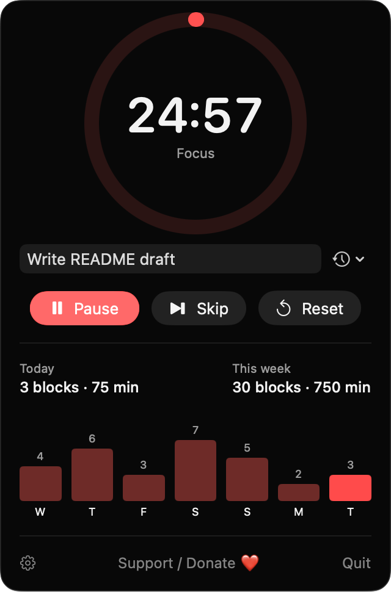
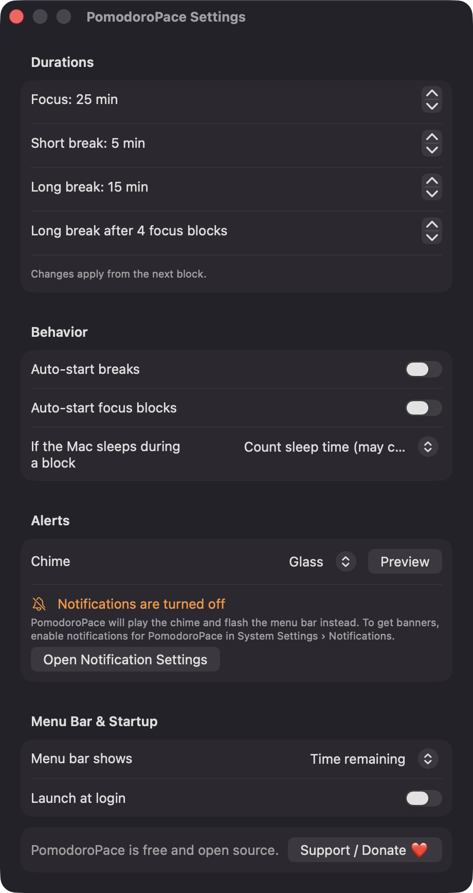
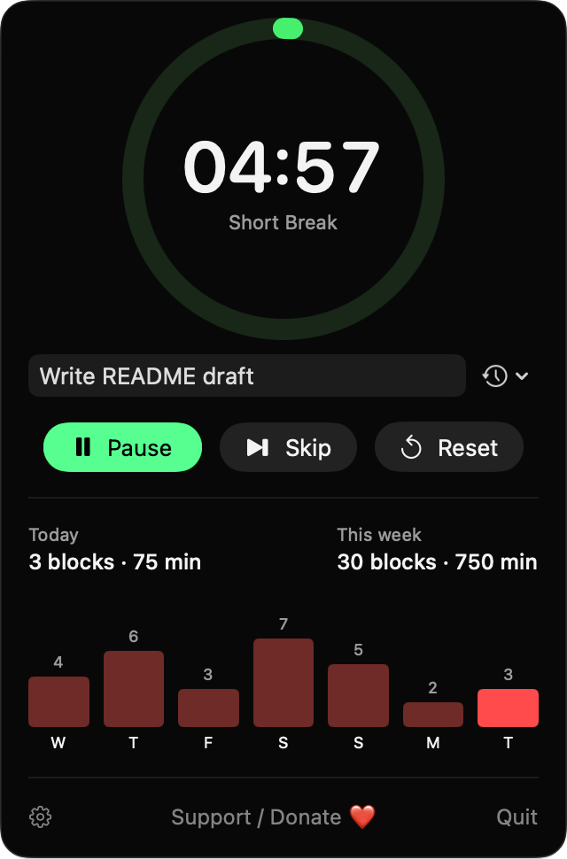

# PomodoroPace

**🌐 Website:** [turhe123.github.io/pomodoro-pace](https://turhe123.github.io/pomodoro-pace/)

A menu bar pomodoro timer with task labels, daily session counts and a gentle chime when each block ends.


## Why

PomodoroPace is a free, open-source, 100% native, backend-free alternative to paid utilities in the *Timers & Reminders* category. Apps such as Be Focused Pro ($4.99 one-time) were the inspiration: a simple pomodoro timer that lives in the menu bar. PomodoroPace is a small SwiftUI app that does the same core job, keeps everything on your Mac, and costs nothing.

## Features

- **Menu bar timer** in a popover with a large countdown ring, the current phase name and Start / Pause, Skip and Reset buttons.
- **Three phases**: Focus, Short Break and Long Break, with a long break after a configurable number of focus blocks (default 25 / 5 / 15 minutes, long break after 4).
- **Task labels**: an optional label per block, plus a menu of your most recent labels (capped at 50).
- **History**: completed focus blocks are saved per day. The popover shows today's blocks, daily and weekly counts with total focused minutes, and a seven-day bar chart. With no data it says "No sessions yet — start your first focus block."
- **End-of-block alerts**: a system sound (14 built-in macOS sounds, or none, with a preview button) and a notification. If notifications are denied, the menu bar title flashes "⏰ Done!" instead and Settings shows a hint.
- **Optional auto-start** for the next break and/or the next focus block.
- **Menu bar display**: shows the remaining time or an icon only, with a red/green dot for focus vs. break.
- **Sleep and clock handling**: deadlines use a monotonic clock, so wall-clock and time zone changes don't break a running block. A setting chooses whether time asleep counts toward the block or the block continues with the time that was left.
- **Keyboard shortcuts** in the popover: Space starts/pauses, S skips, R resets (ignored while typing in the label field).
- **Launch at login** via `SMAppService`.
- **Quit protection**: quitting mid-block asks whether to discard it.
- Duration changes apply from the next block. History older than a year is pruned.

## Screenshots

<p align="center"></p>

<p align="center"><em>The menu bar popover mid-focus block: a countdown ring, a task label, Pause/Skip/Reset controls, and today&#x27;s and this week&#x27;s counts above a seven-day bar chart.</em></p>

<p align="center"></p>

<p align="center"><em>Settings for focus and break lengths, auto-start, sleep handling, the end-of-block chime, menu bar display and launch at login.</em></p>

<p align="center"></p>

<p align="center"><em>During a short break the ring and Pause button turn green so you can tell at a glance that it&#x27;s time to rest.</em></p>

## Install

1. Download `PomodoroPace-macOS.zip` from the [latest release](https://github.com/turhe123/pomodoro-pace/releases/latest).
2. Unzip it and move `PomodoroPace.app` to `/Applications`.
3. Because the app is open source and not notarized, clear the quarantine flag:

   ```bash
   xattr -cr /Applications/PomodoroPace.app
   ```

4. Right-click the app and choose **Open** the first time you launch it.

Requires macOS 14 (Sonoma) or later.

## Build from source

You need Xcode with the macOS 14 SDK.

```bash
brew install xcodegen
xcodegen generate
xcodebuild -project PomodoroPace.xcodeproj -scheme PomodoroPace -configuration Release -derivedDataPath ./build build
```

The app is produced at `build/Build/Products/Release/PomodoroPace.app`.

## Permissions

PomodoroPace asks for very little:

- **Notifications**: requested at first launch to show a banner when a block ends. If you decline, the app still plays the chime and flashes the menu bar title.
- **Login Items** (optional): only if you turn on "Launch at login", which registers the app through macOS's `SMAppService`.

It does **not** request Accessibility, Screen Recording, Microphone, Camera, Contacts, Location or any other privacy permission. Sounds are played from `/System/Library/Sounds`, which needs no access.

Data stored locally: your settings (UserDefaults), recent labels (UserDefaults) and session history (`~/Library/Application Support/PomodoroPace/history.json`).

## Built with AI

PomodoroPace was written by [Claude Code](https://claude.com/claude-code) inside an automated pipeline, from a plain-English spec. No code, binaries or assets from any commercial app were used; it is a clean-room reimplementation of a feature set, not a copy.

What that means in practice:

- The full source is in this repo under the MIT license. Read it before you run it.
- No network calls, no analytics, no third-party dependencies. Only Apple frameworks.
- Ad-hoc signed and not notarized, which is why Gatekeeper warns on first launch.
- It has had less human review than a hand-written app. Bug reports and pull requests are welcome.

## Support ❤️

If PomodoroPace is useful to you, you can support its development:

[Support Or (Leo) Davidai ❤️](https://ko-fi.com/leodavidai)

The app also has a "Support / Donate ❤️" button in the popover and in Settings.

## License

MIT © Or Davidai Bachar

## More free Mac apps

Prefer something that runs in the browser? The same pipeline builds [free, private web tools](https://turhe123.github.io/web-tools/): PDF, image, developer, data and audio tools, nothing uploaded.
